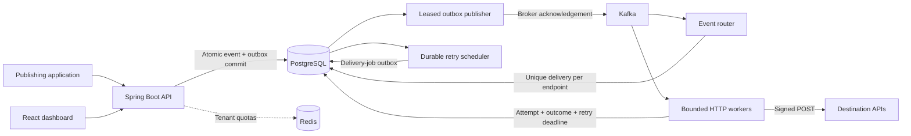

# DispatchGrid

**A multi-tenant webhook delivery and event-processing platform.**

DispatchGrid accepts events durably, routes them through Kafka, and delivers signed HTTP webhooks with retries, delivery history, and manual replay. Java 21 and Spring Boot power separate API and worker processes; a React dashboard provides the management interface.

The local implementation has been tested end to end. GitHub publishing and AWS deployment remain optional setup steps; no hosted deployment or production traffic is claimed.

[Quick start](#quick-start) · [Architecture](#architecture) · [API example](#publish-an-event) · [Tests](#testing) · [Performance](#measured-performance) · [Deployment](#deployment) · [Documentation](#documentation)

## What it does

| Capability | Implementation |
|---|---|
| Durable ingestion | An event and its outbox record commit in one PostgreSQL transaction before HTTP `202`. |
| Multi-tenant access | JWT authentication, current-membership checks, role permissions, tenant-scoped queries, and composite foreign keys. |
| Publisher credentials | Random API keys stored as hashes, with immediate revocation and publishing-only access. |
| Endpoint management | Event subscriptions, enable/disable, safe deletion, retry policies, and signing-secret rotation. |
| Reliable processing | Kafka consumer groups, duplicate-safe routing, database leases, and fenced attempt completion. |
| Failure recovery | Durable retry deadlines, exponential backoff with jitter, abandoned-lease recovery, dead letters, and replay. |
| Webhook security | HMAC-SHA256, AES-GCM encrypted signing secrets, HTTPS enforcement, DNS checks, and SSRF protection. |
| Distributed quotas | Atomic Redis fixed-window rate limits with `429`/`Retry-After`; temporary Redis failure returns `503`. |
| Operations | Structured logs, correlation IDs, Prometheus metrics, and a provisioned Grafana dashboard. |
| Dashboard | Event explorer, payload inspection, endpoint history, attempt timelines, analytics, keys, settings, and team management. |

**Delivery is at least once.** A receiver may commit its work just before a worker crashes. Receivers must deduplicate the stable delivery ID; DispatchGrid does not promise exactly-once delivery to external HTTP endpoints.

## Quick start

### Requirements

- Docker Engine/Desktop with Linux containers and Docker Compose v2. Allow at least 6 GB of Docker memory for builds and the full stack.
- Python 3.10+ for the optional lifecycle demo and benchmark helpers.
- Linux/macOS: OpenSSL for generating local secrets.

The container builds install Java and Node themselves. Host Java, Maven, and Node are only needed for development outside Docker.

Run these commands from the repository root.

**Windows PowerShell**

```powershell
.\scripts\setup-env.ps1
docker compose up -d --build --wait
docker compose ps
```

**Linux/macOS**

```bash
bash scripts/setup-env.sh
docker compose up -d --build --wait
docker compose ps
```

The setup script generates independent random secrets in the ignored `.env` file. It preserves an existing `.env`; `.env.example` documents the available settings. The first build downloads dependencies and container images.

Open **[http://localhost:3000](http://localhost:3000)** and register a workspace. There are no bundled application credentials.

| Service | Local address | Access |
|---|---|---|
| Dashboard | [localhost:3000](http://localhost:3000) | Register or sign in |
| API / Swagger | [localhost:8080/swagger-ui.html](http://localhost:8080/swagger-ui.html) | JWT or publisher API key, depending on route |
| API health | [localhost:8080/actuator/health](http://localhost:8080/actuator/health) | Minimal public health response |
| Mock receiver | [localhost:8090/health](http://localhost:8090/health) | Development control routes require their own token |
| Prometheus | [localhost:9090](http://localhost:9090) | Loopback only |
| Grafana | [localhost:3001](http://localhost:3001) | User `admin`; generated `GRAFANA_ADMIN_PASSWORD` in `.env` |

The worker runs internally on port `8081`. Published service ports bind to `127.0.0.1` by default. This Compose configuration is a development environment; see [Deployment](#deployment) before exposing it.

### Run the complete lifecycle demo

After the stack is healthy:

```bash
python scripts/demo.py
# Linux/macOS: python3 scripts/demo.py
```

The script creates a fresh tenant, API key, and subscribed endpoint, then verifies:

1. Durable ingestion and duplicate request idempotency.
2. Signed delivery accepted by the sample receiver.
3. Automatic retry after HTTP `500`.
4. Retry exhaustion and a terminal delivery record.
5. Manual replay followed by successful delivery.

It saves fresh demo login details in `.local/demo-secrets.json` and outcomes in `.local/demo-result.json`. These files are ignored and are regenerated when needed. The receiver's authenticated control API is a development fixture.

## Architecture



### Event flow

1. Authenticate a publisher and validate its event, payload size, quota, and idempotency key.
2. Commit the event and outbox record together; return `202 Accepted` without waiting for a destination.
3. Claim outbox rows and publish to Kafka. Mark publication only after broker acknowledgement.
4. Route the event to matching subscriptions and create independent delivery records.
5. Claim due work using PostgreSQL leases and publish delivery-job messages through the outbox.
6. Send the signed request outside the database transaction, then record its attempt and outcome.
7. Persist a retry deadline or terminal failure. Recover expired leases after a process restart.

Topics are `dispatchgrid.events`, `dispatchgrid.delivery.jobs`, and `dispatchgrid.delivery.dlq`. Event messages use tenant keys; delivery jobs use endpoint keys. Unique constraints and conditional updates tolerate duplicate messages. Ordering across retries is not guaranteed.

The modular monolith keeps domain and transaction boundaries manageable while API and worker processes scale separately. PostgreSQL owns durable state, Kafka transports notifications, and Redis coordinates admission limits. See the [architecture](docs/architecture.md), [ER diagram](docs/database-design.md), and [failure-recovery guide](docs/failure-recovery.md) for details.

## Technology

| Area | Stack |
|---|---|
| Backend | Java 21, Spring Boot 3.5.16, Spring Security, Bean Validation, Maven |
| Persistence | PostgreSQL 16, Flyway, Spring Data JPA/Hibernate for identity, explicit transactional SQL for work claims |
| Messaging / quotas | Apache Kafka 3.9.1, Spring Kafka, Redis 7 |
| Dashboard | React, TypeScript, Vite, Tailwind CSS, React Router, TanStack Query, Recharts |
| Observability | Actuator, Micrometer, Prometheus, Grafana, structured JSON logging |
| Verification | JUnit 5, Spring Boot Test, Testcontainers, WireMock, Awaitility, Playwright, k6 |
| Packaging / deployment | Docker Compose, Nginx, GitHub Actions, optional EC2 deployment |

## Publish an event

Create an API key from **API keys**, register an endpoint, and subscribe it to `order.created`. Production destinations must be public HTTPS URLs. The local demo configures the explicitly allowed `receiver` hostname automatically.

Set `DISPATCHGRID_API_KEY` in your shell and send:

```bash
curl -X POST http://localhost:8080/api/v1/events \
  -H "Authorization: Bearer $DISPATCHGRID_API_KEY" \
  -H 'Content-Type: application/json' \
  -H 'Idempotency-Key: order-1001-created' \
  -d '{"eventType":"order.created","payload":{"orderId":"ORD-1001","amount":1499,"currency":"INR"}}'
```

<details>
<summary>PowerShell equivalent</summary>

```powershell
$headers = @{
    Authorization = "Bearer $env:DISPATCHGRID_API_KEY"
    "Idempotency-Key" = "order-1001-created"
}
$body = @{
    eventType = "order.created"
    payload = @{ orderId = "ORD-1001"; amount = 1499; currency = "INR" }
} | ConvertTo-Json -Depth 5

Invoke-RestMethod -Method Post -Uri "http://localhost:8080/api/v1/events" `
    -Headers $headers -ContentType "application/json" -Body $body
```

</details>

A `202` response includes the event ID, correlation ID, acceptance time, and `duplicate` flag. Track delivery outcomes in the dashboard.

- `Idempotency-Key` is required and scoped to the tenant for 24 hours.
- Reusing the key with matching content returns the existing logical event.
- Reusing it with different content returns `409 Conflict`.
- Acknowledgement confirms durable acceptance; destination acknowledgement is tracked separately.

The [API reference](docs/api-reference.md) covers authentication, pagination, endpoints, deliveries, replay, analytics, team settings, and error responses.

## Security and configuration

Dashboard sessions use 15-minute JWTs and rotating hashed refresh tokens in HttpOnly cookies. Membership and roles are checked on each request. API keys can publish events but cannot manage or read tenant resources.

Signing secrets are encrypted with AES-256-GCM. Outbound requests carry stable event/delivery IDs, a fresh timestamp, and an HMAC-SHA256 signature over `timestamp + "." + exact body bytes`. Rotation retains the previous key for 24 hours. The [sample receiver](examples/sample-webhook-receiver/README.md) demonstrates signature freshness checks, constant-time comparison, and SQLite deduplication.

Destination validation rejects unsafe URL forms and address ranges. The HTTP client's DNS resolver validates addresses again at connection time, and redirects are disabled. Development exceptions are exact hostnames; the production override clears them.

| Setting | Purpose |
|---|---|
| `DB_USERNAME`, `DB_PASSWORD` | Database credentials |
| `JWT_SECRET` | Access-token signing key; at least 32 bytes |
| `ENCRYPTION_KEY` | Base64 of 32 random bytes for stored signing secrets |
| `MONITORING_TOKEN` | Separate bearer token for `/actuator/prometheus` |
| `GRAFANA_ADMIN_PASSWORD` | Initial Grafana administrator password |
| `RECEIVER_CONTROL_TOKEN` | Local receiver configuration access |
| `WORKER_CONCURRENCY` | Delivery consumer threads per worker; default `8` |
| `OUTBOX_POLL_MS` | Delay between publisher batches; default `20` ms |
| `API_PORT`, `DASHBOARD_PORT`, `GRAFANA_PORT`, `PROMETHEUS_PORT`, `RECEIVER_PORT` | Loopback port mappings |

Compose supplies local database, broker, and Redis addresses. Host development scripts provide their host equivalents. Runtime settings, secure-cookie configuration, retention, and deployment secrets are documented in [deployment.md](docs/deployment.md). Keep `.env` and encryption-key backups private; changing the encryption key requires re-encrypting stored secrets.

## Local development

Install **JDK 21, Maven 3.9+, and Node.js 22.12+**. Open the root `pom.xml` in IntelliJ IDEA and select JDK 21.

Start dependencies and build the applications from the repository root:

```bash
docker compose up -d postgres kafka redis receiver
mvn -B -ntp package -DskipTests
```

Run each process in its own terminal:

| Process | Windows PowerShell | Linux/macOS |
|---|---|---|
| API | `.\scripts\run-local.ps1 api` | `bash scripts/run-local.sh api` |
| Worker | `.\scripts\run-local.ps1 worker` | `bash scripts/run-local.sh worker` |
| Dashboard | `cd frontend`, then `npm ci` and `npm run dev` | Same commands |

The Vite development server proxies `/api` to `localhost:8080`. Flyway applies migrations on application startup; Hibernate validates the schema. Stop host Java processes before replacing their JARs on Windows, and avoid running host and container APIs on the same port.

For the demo with host Java, use:

```bash
python scripts/demo.py --destination http://localhost:8090/webhook
```

## Testing

Run backend checks from the repository root:

```bash
mvn test                         # Unit tests; no Docker required
mvn -B -ntp verify               # Unit + real Testcontainers integration tests
mvn spotless:check              # Java formatting check
python -m unittest discover -s examples/sample-webhook-receiver -p 'test_*.py'
```

Install frontend dependencies and verify the build:

```bash
npm --prefix frontend ci
npm --prefix frontend run build
npm --prefix frontend audit --omit=dev --audit-level=high
```

For browser checks, first start the full Compose stack and run `scripts/demo.py` to create fresh fixtures. Then:

```bash
cd frontend
npx playwright install chromium
npm run test:e2e
cd ..
```

Last full verification on **2026-10-18**:

| Check | Result |
|---|---|
| Backend | 26 passed: 9 unit + 6 API integration + 11 worker integration |
| Browser | 2 passed: dashboard lifecycle/session/mobile and Grafana |
| Sample receiver | 4 signature tests passed |
| Local deployment | All nine containers healthy; complete signed-delivery/retry/replay demo passed |
| Load measurements | Nine completed k6 runs with saved summaries |

Integration checks cover tenant isolation, concurrent idempotency, rollback when outbox insertion fails, distributed quotas, duplicate processing, lease recovery, competing workers/schedulers, HTTP failures/timeouts, and consumer restart. These counts describe the recorded local run; rerun the commands above to verify the current revision.

## Measured performance

In the same local burst workload, reducing outbox polling from 100 ms to 20 ms produced:

| Measurement | Before | After |
|---|---:|---:|
| Delivery p95, including queue time | 7,705.23 ms | 1,019.08 ms |
| Completed deliveries | 555 / 555 | 555 / 555 |
| Terminal or pending deliveries at completion | 0 | 0 |

The tuned run's ingestion p95 was **17.82 ms**. The burst ramped through 1 → 10 → 40 → 10 requests/second over 30 seconds. These are local measurements on an i7-13620H / 16 GB Windows machine with Docker, not production capacity guarantees.

The other workloads exercise sustained publishing, three-destination fan-out, slow destinations, retry volume, and one/two worker replicas. Full parameters, latency percentiles, CPU/memory samples, backlog/lag captures, and caveats are in [performance.md](docs/performance.md). Benchmark summaries and resource samples remain in `performance/results/`; per-request logs are generated locally and ignored by Git.

Reproduce after creating demo fixtures:

```powershell
.\scripts\load-test.ps1 -Rate 5 -Duration 30s
python scripts/benchmark-suite.py
python scripts/collect-benchmark-metrics.py
python scripts/report-results.py
```

On Linux/macOS use `bash scripts/load-test.sh` and `python3`. The suite temporarily changes the demo tenant's quota, benchmark endpoints, receiver behavior, and worker replica count, then restores them.

## Repository layout

```text
backend/
  dispatchgrid-common/       Schema, cryptography, destination/retry policy, Redis quotas
  dispatchgrid-api/          Authentication, tenant/endpoint management, ingestion, queries
  dispatchgrid-worker/       Outbox, Kafka routing, delivery, retries, recovery, metrics
frontend/                    React dashboard and browser tests
infrastructure/              Dockerfiles, Nginx, Prometheus, Grafana, production override
examples/                    Verifying development webhook receiver
scripts/                     Environment setup, host runtime, demo, measurements, reports
performance/                 k6 workloads and completed benchmark evidence
docs/                        Architecture, ER/state diagrams, security, operations, performance
.github/workflows/           Verification, image scanning/publishing, optional deployment
```

Build outputs, `node_modules`, caches, browser reports, temporary logs, and demo credentials are generated locally and excluded from Git. Docker build contexts also exclude documentation, benchmark records, and unrelated development artifacts. Runtime images contain the application JAR or dashboard static files; tests, examples, and measurements remain in the repository for reproducibility.

## Deployment

The default Compose stack is for local use. For an approved host with HTTPS, protected secrets, backups, and restricted network access, a production override is provided:

```bash
docker compose -f docker-compose.yml \
  -f infrastructure/docker/compose.production.yml up -d --build --wait
```

The override enables Secure cookies, removes private destination exceptions, disables development Swagger, and excludes the mock receiver. The [deployment guide](docs/deployment.md) covers Ubuntu/EC2, Nginx/TLS, environment secrets, persistence, backup, rollback, and the limits of the single-host topology.

GitHub Actions configuration includes backend/integration checks, frontend build and dependency checks, a Compose/browser smoke test, Docker image scanning, and commit-SHA image publishing. The separate EC2 workflow is manually triggered against preconfigured infrastructure and a protected GitHub environment. These remote workflows have not been executed under this project account.

### Routine operations

```bash
docker compose logs -f api worker
docker compose stop                # Stop services; keep containers and data
docker compose down                # Remove containers/network; keep named data volumes
```

To deliberately reset **this project's local data**, `docker compose down -v` also removes its database and other named volumes. Rebuild dependencies with Maven or `npm ci` when returning to host development after a source-tree cleanup.

## Limits and trade-offs

- Local PostgreSQL and Kafka run as single instances; the bundled topology is not highly available.
- External HTTP delivery can be duplicated. Receiver deduplication is part of the contract.
- Retries can reorder delivery. Subscriptions are evaluated when the router processes the event.
- A single endpoint maps to one delivery partition; extra worker replicas do not guarantee linear throughput for that endpoint.
- Fixed-window quotas permit boundary bursts. Faster outbox polling trades additional database activity for lower queueing delay.
- Event, attempt, dead-letter, and audit history require an operator-defined archival policy. Managed encryption-key rotation and broader tracing/chaos testing remain future improvements.

## Documentation

| Guide | Contents |
|---|---|
| [Architecture](docs/architecture.md) | Modules, event flow, outbox, retry state machine, scaling |
| [Database design](docs/database-design.md) | Mermaid ER diagram, constraints, indexes, retention |
| [API reference](docs/api-reference.md) | Routes, request/response contracts, pagination, errors |
| [Security](docs/security.md) | Authentication, tenant access, HMAC, encryption, SSRF |
| [Failure recovery](docs/failure-recovery.md) | Crash windows, leases, duplicate handling, operations |
| [Design decisions](docs/design-decisions.md) | Engineering choices and alternatives |
| [Deployment](docs/deployment.md) | EC2, HTTPS, CI configuration, backup and rollback |
| [Performance](docs/performance.md) | Actual workloads, result summaries, resource samples, findings |
