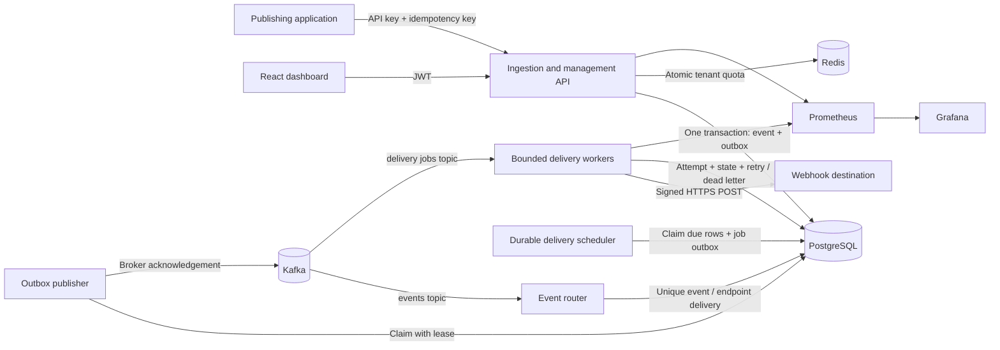
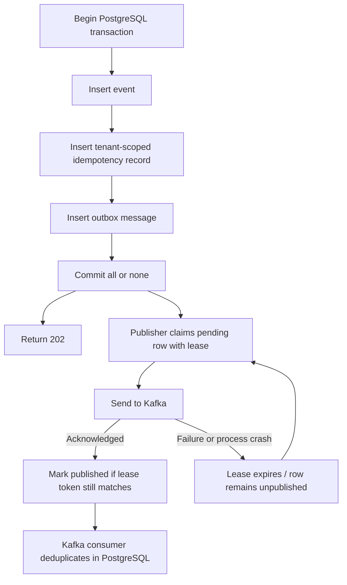
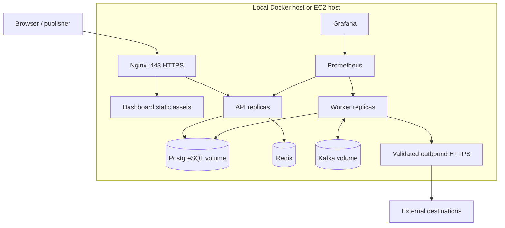

# Architecture

DispatchGrid accepts events durably, then delivers signed HTTP webhooks asynchronously. PostgreSQL is the source of truth for event identity, routing, attempts, retries, and terminal outcomes. Kafka transports work; Redis enforces the ingestion quota.

The repository is a modular monolith with two executable Spring Boot applications. This keeps deployment and transaction boundaries understandable while allowing API and worker capacity to scale independently.



## Module and process boundaries

| Module | Responsibility |
| --- | --- |
| `backend/dispatchgrid-common` | Flyway schema, shared configuration, signing and encryption, destination validation, messaging contracts, database helpers |
| `backend/dispatchgrid-api` | Registration/login, JWT and API-key authentication, tenant authorization, endpoints, ingestion, replay and analytics |
| `backend/dispatchgrid-worker` | Outbox publication, Kafka routing, delivery scheduling, HTTP execution, retries and dead letters |
| `frontend` | React management client; all access control remains on the server |
| `infrastructure` | Container images, proxy and monitoring configuration |
| `examples/sample-webhook-receiver` | Receiver-side signature validation and stable-delivery-ID deduplication example |
| `performance/k6` | Reproducible scenarios and raw measured results |

The API never waits for a destination response. The `202 Accepted` boundary is the successful PostgreSQL commit. Workers may be restarted without losing accepted events or retry deadlines. Database row locks, unique constraints, and lease fencing provide concurrency correctness across processes; Java locks do not.

## Event lifecycle

```mermaid
sequenceDiagram
    participant C as Client
    participant A as API
    participant P as PostgreSQL
    participant O as Outbox publisher
    participant K as Kafka
    participant W as Worker
    participant D as Destination
    C->>A: Publish event + API key + idempotency key
    A->>A: Authenticate, validate, apply tenant quota
    A->>P: BEGIN; event + idempotency record + outbox; COMMIT
    P-->>A: Commit complete
    A-->>C: 202 event ID + correlation ID
    O->>P: Claim unpublished outbox row
    O->>K: Publish event reference
    K-->>O: Broker acknowledgement
    O->>P: Mark published using lease token
    K->>W: Route event
    W->>P: Insert matching deliveries, ON CONFLICT DO NOTHING
    W->>P: Claim due delivery + enqueue job atomically
    O->>K: Publish delivery job
    K->>W: Delivery ID + lease token
    W->>P: Validate lease and prepare attempt
    W->>D: HMAC-signed HTTP POST
    D-->>W: Response or bounded timeout
    W->>P: Record attempt and success / retry / terminal outcome
```

## Transactional outbox



A normal database transaction and Kafka send are independent commits. Sending first risks publishing an event whose database transaction rolls back. Committing first without an outbox risks a crash before sending. An outbox makes the publication intention durable with the event. A crash after Kafka acknowledgement but before `published_at` can publish twice; durable consumer deduplication is consequently required.

## Retry state machine

```mermaid
stateDiagram-v2
    [*] --> PENDING: Subscription routed
    PENDING --> PROCESSING: Scheduler claims due work
    RETRY_SCHEDULED --> PROCESSING: Deadline reached and lease acquired
    PROCESSING --> DELIVERED: HTTP 2xx
    PROCESSING --> RETRY_SCHEDULED: Retryable failure; attempts remain
    PROCESSING --> FAILED: Non-retryable failure
    PROCESSING --> EXHAUSTED: Retry budget spent
    PROCESSING --> PROCESSING: Expired lease reclaimed with a new token
    FAILED --> PENDING: Authorized manual replay
    EXHAUSTED --> PENDING: Authorized manual replay
```



Each endpoint has an independent delivery. A retry deadline is stored in PostgreSQL and survives restarts. Replay starts another attempt generation while retaining earlier attempts and dead letters. A stale job or a stale worker completion cannot mutate a newer lease.

## Kafka and ordering

`dispatchgrid.events` carries event references, `dispatchgrid.delivery.jobs` carries delivery IDs and lease tokens, and `dispatchgrid.delivery.dlq` carries terminal-failure references. PostgreSQL retains authoritative payloads and delivery state. Consumers commit offsets only after successful handling. A database commit followed by consumer termination before offset commit causes reprocessing, which is expected and safe.

Keys place related messages in one Kafka partition, but parallel HTTP processing and independent retries can reorder webhook arrival. DispatchGrid does not promise ordered destination delivery. Receivers needing business ordering should use domain sequence numbers or versions.

## Deployment topology



One-host Compose provides a reproducible development environment. It is not a highly available production topology. A production rollout should use resilient managed data services or redundant clusters, off-host backups, network egress controls, and an external secrets manager. Cloud provisioning requires separately supplied credentials and approval.

## Delivery guarantees

At-most-once processing acknowledges before durable work and may lose an event on failure. At-least-once processing retries unacknowledged work and can duplicate it. Exactly-once processing requires every side effect to share an atomic deduplication boundary. Arbitrary external HTTP services do not share DispatchGrid's database transaction, so the supported guarantee is **at-least-once delivery attempts** with stable event and delivery identifiers. If the receiver processes a webhook and the worker crashes before persisting success, the receiver may see that webhook again.

See [database-design.md](database-design.md), [failure-recovery.md](failure-recovery.md), and [design-decisions.md](design-decisions.md) for invariants and operational trade-offs.
