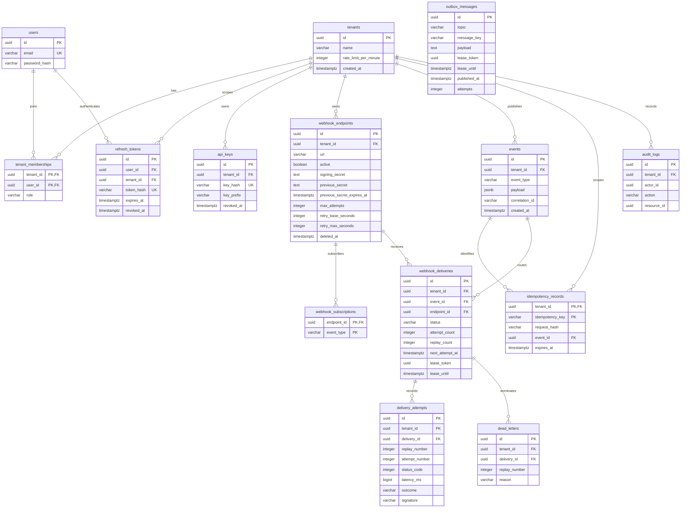

# Database design

PostgreSQL 16 holds all durable business state. Flyway migration `backend/dispatchgrid-common/src/main/resources/db/migration/V1__initial_schema.sql` is the schema authority. IDs use UUIDs and timestamps use `TIMESTAMPTZ`.

Outbox messages deliberately have no foreign key to a particular aggregate: the same table transports event, delivery-job, and dead-letter messages. Their payload schema identifies the aggregate. This prevents separate, subtly different outbox implementations.

## Correctness constraints

| Constraint | Invariant |
| --- | --- |
| `idempotency_records (tenant_id, idempotency_key)` primary key | Two clients cannot create separate live idempotency records for one tenant/key |
| `webhook_deliveries (event_id, endpoint_id)` unique | Repeated routing creates one logical delivery per destination |
| Composite tenant/event and tenant/endpoint foreign keys | A delivery cannot reference another tenant's event or endpoint |
| Composite tenant/delivery foreign keys | Attempts and dead letters cannot be attached across tenants |
| `delivery_attempts (delivery_id, replay_number, attempt_number)` unique | Each attempt number occurs once within a replay generation |
| `dead_letters (delivery_id, replay_number)` unique | Terminal processing cannot create duplicate dead letters in a generation |
| Role, state, quota and retry-policy checks | Invalid durable state is rejected independently of API validation |

Tenant isolation also requires every API query to constrain the authenticated tenant. Foreign keys do not replace authorization. Raw API keys and refresh tokens are not stored; only their hashes are durable. Endpoint secret columns hold authenticated ciphertext, not plaintext.

## Indexes and query patterns

Tenant/time indexes support paginated event, endpoint, delivery and dead-letter views. `(tenant_id, event_type, created_at)` supports event filtering. A partial due-delivery index excludes terminal rows; a separate partial processing-lease index supports abandoned-work recovery. A partial unpublished-outbox index avoids rescanning published history. Endpoint delivery history has its own tenant/endpoint/time index.

Schedulers use short transactions with row locks and `SKIP LOCKED` so other replicas can claim different rows. A lease token acts as a fencing token: every completion checks that it still owns the row. Outbound HTTP and Kafka broker waits occur outside business-state row-lock transactions.

## Retention and cleanup

Data deletion is an operational policy, not a hidden startup behavior. The initial application retains events, delivery attempts, audit entries and dead letters until an operator applies an approved retention policy. Expiring ingestion idempotency records allows a reused key to create a new logical event; the API documents its configured window.

Recommended starting policy, to adapt to customer requirements:

- Retain events and attempts for 30 days and dead letters for 90 days; export any required audit history before deletion.
- Delete published outbox rows after seven days only when consumers have safely advanced beyond the associated workload. Never delete unpublished rows to reduce a backlog.
- Remove expired/revoked refresh tokens after the required audit interval.
- Delete expired idempotency records before deleting events; never remove active idempotency references.
- Delete old attempt and dead-letter children, then terminal deliveries, then unreferenced events, in small transactions. Never delete pending/retrying/leased work.
- Keep endpoint tombstones while any historical delivery references them. Endpoint deletion is a soft deletion so history remains interpretable.

The worker implements bounded housekeeping for published outbox rows older than seven days, expired idempotency records, old expired refresh sessions, and previous signing secrets after the overlap. It does not automatically delete event, delivery, attempt, dead-letter or audit history; the 30/90-day history durations above are recommendations. Monitor table growth and autovacuum. Backup and restore procedures must be validated before enabling destructive history retention. A future partitioning migration should be driven by measured table volume and retention workload.
